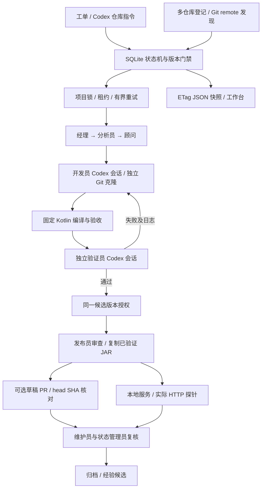

# 架构：控制状态、真实执行、独立证据

## 参考页的可确认事实

参考 [开发直播页](https://codexradar.com/dev-live/) 和 [公开快照](https://codexradar.com/api/development-live/current)。2026-10-29 观察到的内容时间为 `2026-10-29T06:39:20.334969Z`。

- 页面说明工单对应站长电脑里的 Codex 会话，展示常驻职责、状态和工单内容。
- 常驻状态管理员是 `gpt-6-luna / max`；顾问、维护和经理为 `gpt-6.1-sol / high`。
- 当前工单 264 使用 `gpt-6.1-sol / high`。原站没有公开固定的分析/开发/验证/发布模型映射，本仓库以此作为执行角色默认值。
- 客户端以公开字段快照显示状态，包含版本校验和旧快照处理。公开 UI 不足以证明其后台调度、安全隔离或发布实现。

本仓库按这些可观察行为实现同类架构，不宣称取得或复制了原站后台源码。

## 三层结构

## 状态与执行

`pending → analyzing → developing → verifying → awaiting_release → releasing → observing → done`。

验证失败回到开发，最多两轮；异常、持续失败和观察不通过进入 `blocked`。人工停止进入 `stopped`。完成、停止、阻塞互不混计。常驻职责数量不冒充运行会话数。

控制器持有 SQLite WAL 事务。领取阶段时分配 token 和项目锁，执行过程中每两秒续约；完成必须匹配同一 token、状态和未过期租约。本地发布短操作在同一事务内检查租约。重试阶段写入新的目录，旧执行不能覆盖新候选。GitHub 网络操作单独检查和续租，不能与 SQLite 原子提交；使用持久化意图、确定分支、先查后建和版本核对恢复结果。

## 真实 Codex 适配器

每个角色用独立 `codex exec`，显式传模型、推理强度、JSON 输出契约和超时。所有角色使用 `read-only`，开发员通过结构化输出返回单文件内容及原始 SHA-256；控制器校验路径、摘要和租约后写入独立仓库。不依赖子 Codex 的 Shell 权限，不使用禁用沙箱参数。会话必须同时有成功退出、`thread.started`、`turn.completed` 和合规结构化输出。

不同角色以提示和独立会话分工，不等同于不同操作系统身份。`AGENTS.md` 不是安全沙箱；测试仓库隔离、CLI 沙箱、允许改动检查和可信控制命令共同限定范围。当前是单机可信操作员原型，不是可接收恶意租户的执行平台。

## 候选、验收与发布

- 源码候选身份：Git commit + 唯一允许源码的 SHA-256 + 受保护文件清单摘要。
- 固定验收保存在控制仓库。开发员不能修改它，验证时复制可信文件到新的构建目录。
- 候选仓库必须干净、HEAD 和受保护字节必须一致。`.gitattributes` 与 `core.autocrlf=false` 避免 Windows 换行转换破坏摘要。
- 验证必须实际编译成功、20 项测试全通过、独立审查通过。模型自述不能替代测试退出码。
- 发布复制已验证的 JAR，并核对字节摘要；不在发布时重编译。授权、验证、发布绑定同一候选。
- 发布到 127.0.0.1 临时端口，HTTP 运行实际 Kotlin 策略。健康接口校验发布清单，五项行为探针覆盖正向与负向路径。
- 可选 GitHub 草稿 PR 目标来自工单关联仓库。预览同时绑定仓库、remote、base 与候选摘要；发布时沿独立克隆的本地 origin 链重新核对，拒绝把来源 issue 当目标。
- 发布前 fetch 目标分支到内部 ref，要求 base 是验证提交的祖先且差异仅含允许的策略文件。新分支使用空 expected ref 的 lease，防止并发覆盖。PR 回读核对仓库、分支、head SHA、草稿状态和身份标记；CI 是否通过不由本地测试代替。

## 多仓库登记

`repositories.py` 规范化 Git 根目录并按路径去重，将仓库信息保存在 SQLite。登记和重新识别只读 Git 元数据，不改源代码；无 GitHub remote 仍可登记。只支持 GitHub HTTPS/SSH remote，多个不明确的 GitHub remote 不自动猜测。

`kotlin-policy` 适配器在独立克隆内验证固定契约；未接入适配器的项目只显示仓库信息，禁止执行。仓库 ID 是工单的项目锁与关联键。模型不能选择任意路径或远程目标。

## 持久化和接口

`tasks` 工单及授权发布计划、`repositories` 仓库登记、`runs` 分阶段证据、`events` 状态事件、`project_locks` 互斥、`approvals` 版本授权、`publications` 已核验 PR 回执、`lessons` 经验候选、`metadata` 数据库模式。

- `GET /api/health`、`GET /api/snapshot`、`GET /api/tasks/{id}`。
- `GET /api/repositories`、`POST /api/repositories`（path、可选 name）、`POST /api/repositories/{id}/refresh`。
- `GET /api/tasks/{id}/release` 返回仓库、自动发现的计划摘要和发布地址。`approve` 可接受 `include_pr: true` 和相同 `plan_digest`；默认只发布本地服务。
- `POST /api/tasks` 需要幂等键；标题/描述仅作为数据，不能指定命令。
- `POST /api/tasks/{id}/start|approve|stop|retry|resume`。`resume` 只允许执行异常后的原阶段重试，不能绕过持续验收失败的修复上限。
- 写接口要求本地 Host/Origin 和专用头；前端使用 textContent、ETag、旧版本拒收和失败保留最近快照。

此 HTTP 服务只监听回环地址。没有公网登录、多租户授权或云端 CI/CD。发布分为本机测试服务和可选草稿 PR，都不能称为生产部署。经验只写入候选表，不自动改个人记忆或自身指令。
